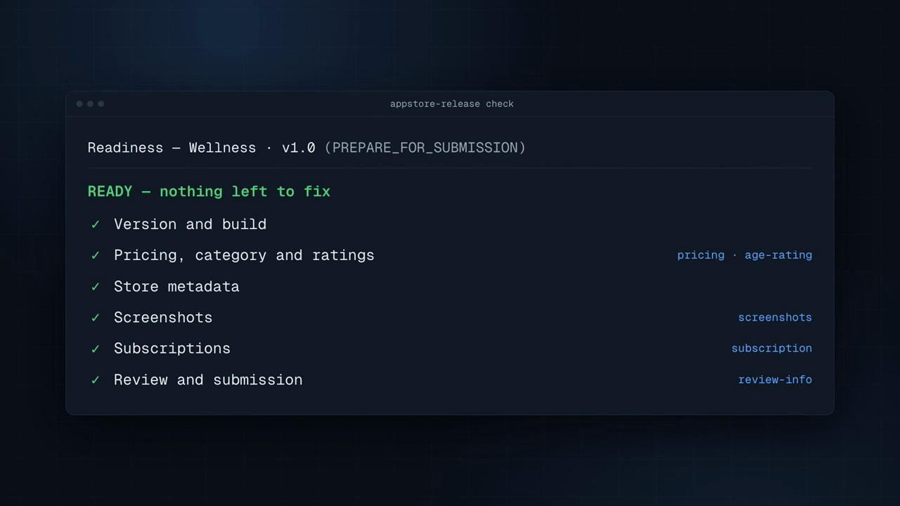
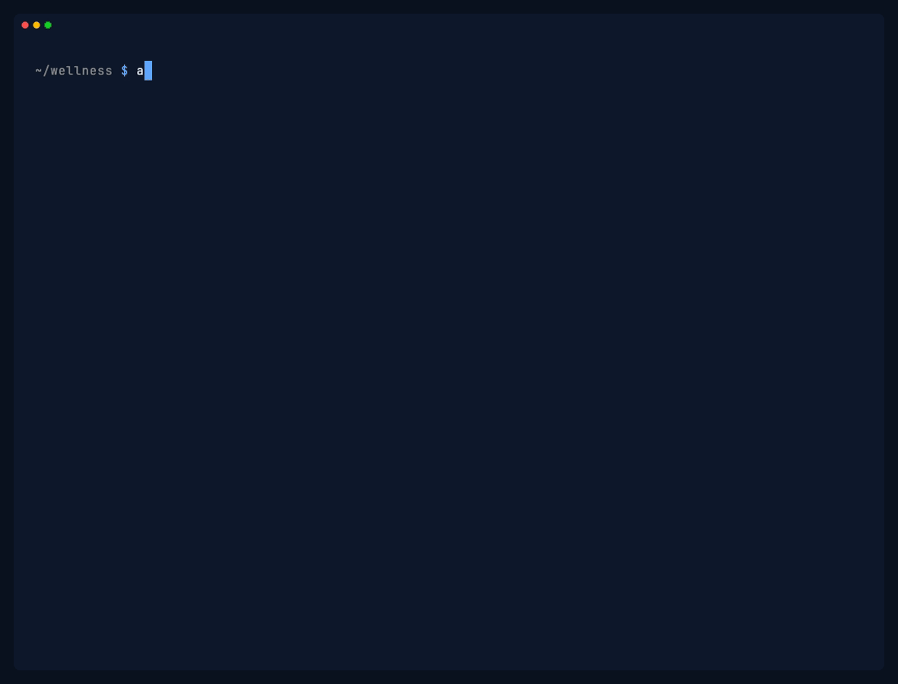

<div align="center">

# appstore-release

**Tell your agent _"ship it"_. Your iOS app goes all the way to App Store review.**

Agent skills, an MCP server and a CLI that drive an App Store submission over the App Store Connect API. A readiness report says what is in the way and who can fix it, then an idempotent pipeline fixes everything Apple's API allows.

[](https://skills.sh/beydemirfurkan/appstore-release)
[](https://github.com/beydemirfurkan/appstore-release/actions/workflows/ci.yml)
[](LICENSE)
[](#requirements)
[](#mcp-server)
[](#updated-for-ios-27)


<sub>Real output, recorded against a local fake of App Store Connect. You can [run the same demo yourself](#try-it-in-a-minute-no-apple-account-needed).</sub>

<a href="https://github.com/beydemirfurkan/appstore-release/releases/latest/download/appstore-release-promo.mp4"></a><br>
<sub>▶ <a href="https://github.com/beydemirfurkan/appstore-release/releases/latest/download/appstore-release-promo.mp4">Watch the 40-second overview</a></sub>

</div>

## Install

Pick whichever matches your tools. They share one engine, and none of them installs any dependencies.

**Any agent (Claude Code, Codex, Cursor, Gemini CLI and others), via [skills.sh](https://skills.sh/beydemirfurkan/appstore-release)**

```bash
npx skills add beydemirfurkan/appstore-release
```

**Claude Code plugin** (adds the skills and the MCP server together)

```
/plugin marketplace add beydemirfurkan/appstore-release
/plugin install appstore-release@beydemirfurkan
```

**Claude Desktop**: download [`appstore-release.mcpb`](https://github.com/beydemirfurkan/appstore-release/releases/latest/download/appstore-release.mcpb) and open it. It asks for your key and installs the MCP server. The same server is listed in the [MCP Registry](https://registry.modelcontextprotocol.io) as `io.github.beydemirfurkan/appstore-release`.

**Any other MCP host** (Cursor, Zed and the rest): see [MCP server](#mcp-server) below.

**CLI**

```bash
git clone https://github.com/beydemirfurkan/appstore-release.git
node appstore-release/src/cli.mjs --help
```

Then tell your agent things like:

> _"Publish my app for review."_ · _"Why can't I submit this version?"_ · _"Upload the new screenshots, including iPhone Duo."_ · _"Apple rejected 1.2 — help me fix it and resubmit."_ · _"Set up the monthly subscription at $4.99 and send it with the next version."_

## Try it in a minute (no Apple account needed)

The repo ships a fake App Store Connect that behaves like the real one for every endpoint this tool uses. Run the full flow against it locally. Nothing leaves your machine.

```bash
git clone https://github.com/beydemirfurkan/appstore-release.git && cd appstore-release
source scripts/demo/setup.sh          # fake API + a demo app called "Wellness"
appstore-release check                # 12 things in the way, in the order to fix them
appstore-release release --dry-run    # every change it would make, sending nothing
appstore-release release              # make them
appstore-release submit --submit      # app + its first subscription go to App Review
demo-stop
```

## What it does



`check` is the important command. It reads the whole app from App Store Connect and returns a **verdict**: `ready`, `blocked`, `needs-human`, `in-review`, `rejected` or `live`. With it comes an **ordered plan**, and every finding records who can fix it:

- **`[fix]`**: this tool can fix it. The plan names the command.
- **`[you]`**: Apple has no API for it. The plan gives the exact clicks in App Store Connect.

`release` then runs the whole listing pipeline: build, metadata in every locale, price, content rights, age rating, category, review details, release timing, screenshots and subscription. A second run with nothing changed sends nothing. `submit --submit` refuses unless the verdict is `ready`.

## Agent skills

One router skill and five focused ones. The router reads `check` and hands each finding to the skill that knows that area. Every skill also works on its own.

| Skill                                                    | Use it for                                                                                  |
| -------------------------------------------------------- | ------------------------------------------------------------------------------------------- |
| [`appstore-release`](skills/appstore-release/SKILL.md)   | "Publish my app": orient, fill the listing, submit. Routes everything else.                 |
| [`asc-screenshots`](skills/asc-screenshots/SKILL.md)     | Exact sizes, iPhone Duo, iPad, App Asset Library vs legacy sets, capturing with `simctl`    |
| [`asc-age-rating`](skills/asc-age-rating/SKILL.md)       | The 2026 questionnaire (13+/16+/18+), social media, loot boxes, rating overrides            |
| [`asc-subscriptions`](skills/asc-subscriptions/SKILL.md) | Localizations, price points, the paywall review screenshot, submitting a first subscription |
| [`asc-rejection`](skills/asc-rejection/SKILL.md)         | The rejected verdict: read Resolution Center, map it to a fix, resubmit                     |
| [`asc-credentials`](skills/asc-credentials/SKILL.md)     | EAS builds failing on certificates or profiles, Apple's three-certificate cap               |

Skills follow the [Agent Skills](https://agentskills.io) format. Each one carries a tiny launcher (`scripts/asc.mjs`), so it works even after `npx skills add` has copied only the skill folder. [AGENTS.md](AGENTS.md) covers agents that read that file instead.

## This is not another App Store Connect API wrapper

Several MCP servers expose the App Store Connect API, some with more than a thousand tools. Raw endpoint coverage is not what's scarce. An agent that can call `PATCH /v1/appStoreVersionLocalizations/{id}` still does not know that:

- `whatsNew` returns **409 STATE_ERROR** on a first version,
- an emoji in the description is a hard **409 ATTRIBUTE.INVALID.INVALID_CHARACTERS**,
- the age-rating declaration lives on `appInfos`, not the version, and must be sent complete,
- a screenshot that skips its commit step stays invisible forever, with nothing in the UI to say why,
- the App Asset Library's placement groups come from runtime reference data, not an enum.

Endpoint coverage hands the model these landmines. This tool defuses them with **11 outcome-shaped MCP tools**, and the most important one answers the question that matters: _can this version be submitted, and if not, what is next?_

## Updated for iOS 27

App Store Connect API 4.4.1 and 4.5.1 (September/October 2026) changed how submission works. This release follows them:

- **App Asset Library.** Screenshots upload through the library, the only place iPhone Duo screenshots exist. Placement groups and exact pixel specs are read from `appAssetLibraryRefData`, so a new device needs no update here. Files are deduplicated across locales. The deprecated screenshot-set API remains a fallback (`screenshots.api`).
- **iPhone Duo.** Add a set with `placementGroup`; `screenshots --list-groups` prints what Apple offers. `check` reminds you before Apple's April 2027 requirement for apps built with the iOS 27.1 SDK.
- **First subscriptions go through the API.** Versioned subscriptions and groups are added to the same review submission as the app version. This used to be a manual step in the web UI.
- **Age rating.** `INFREQUENT`/`FREQUENT` (older spellings still accepted), `socialMedia` and `socialMediaAgeRestricted` (required since September 2026), and `ageRatingOverrideV2`.
- **Sizes.** Every accepted 6.9" and 13" size and landscape. Screenshots with an alpha channel are refused before upload.

What no API exposes, and the skills therefore cover as guidance: builds must use the iOS 27 SDK from April 2027, and an iOS 27 SDK build needs a launch screen and the scene lifecycle.

## The one step Apple keeps in the UI

**App Privacy → Data Collection.** Every `appDataUsages*` endpoint returns 404. `check` blocks with the exact clicks until you publish the label in App Store Connect and set `"review": { "privacyPublished": true }`. That records your word for it; it is not presented as verified.

## Quick start with a real app

1. **Create an API key**: App Store Connect → Users and Access → Integrations → App Store Connect API, role **App Manager**. Download the `.p8` and note the Key ID and Issuer ID ([setup](skills/appstore-release/references/setup.md)).
2. **Scaffold a config** with `appstore-release init`. It writes `appstore.config.json` with a `$schema`, so editors autocomplete it. The [template](skills/appstore-release/references/config-template.json) shows every block: locales, screenshot sets, paid price, age rating, subscription.
3. **Run it:**

```bash
export ASC_KEY_ID=ABCDE12345
export ASC_ISSUER_ID=69a6de00-…
export ASC_P8_PATH=/abs/AuthKey_ABCDE12345.p8   # or ASC_P8 with the key inline
export ASC_APP_ID=1234567890                    # the digits in the App Store Connect URL

appstore-release doctor              # credentials, tools and config; touches no app data
appstore-release check               # what is missing, in the order to fix it
appstore-release release --dry-run   # exactly what would change
appstore-release release             # apply it; safe to re-run
appstore-release submit --submit     # refuses unless the verdict is ready
```

(`appstore-release` is `node /path/to/src/cli.mjs`: symlink it, alias it, or spell it out.)

## Commands

| Command                    | What it does                                                                        |
| -------------------------- | ----------------------------------------------------------------------------------- |
| `init` `schema` `validate` | scaffold a config, print its JSON Schema, check it offline (no credentials needed)  |
| `doctor`                   | verify credentials, `openssl`, Node and config without touching app data            |
| `status`                   | full read-only inventory                                                            |
| `check`                    | readiness report: verdict, findings, ordered next actions                           |
| `release`                  | the whole listing pipeline, then a check                                            |
| `new-version [x.y.z]`      | open the next version when every version is live                                    |
| `attach-build`             | attach the newest VALID build for this version (or `--build <n>`)                   |
| `metadata`                 | name, subtitle, description, keywords, promo text, URLs, in every configured locale |
| `pricing`                  | price schedule (free or paid, nearest price point) and copyright                    |
| `content-rights`           | third-party content declaration                                                     |
| `age-rating`               | the full age-rating declaration                                                     |
| `category`                 | primary and secondary category                                                      |
| `review-info`              | App Review contact and demo account                                                 |
| `release-options`          | manual, after approval, scheduled, phased release                                   |
| `screenshots`              | diff, then upload; `--list-groups`, `--no-prune`                                    |
| `subscription`             | localizations, price, paywall review screenshot                                     |
| `submit --submit`          | submit the version and any subscription that needs review                           |
| `credentials`              | distribution certificate and provisioning profile (fixes stale EAS credentials)     |
| `mcp`                      | run the MCP server on stdio                                                         |

`appstore-release <command> --help` lists a command's own flags. Global flags: `--json` (one JSON document on stdout), `--dry-run`, `--config`, `--project-root`, `--app-id`, `--verbose`, `--quiet`, `--exit-zero`.

**Exit codes are designed for scripts:** `0` ok · `2` usage · `3` config/credentials · `4` blocked but fixable · `5` only a human in App Store Connect can finish. That makes `appstore-release check && appstore-release submit --submit` safe in CI.

## MCP server

Point any MCP host at the file. There is nothing to install:

```jsonc
{
  "mcpServers": {
    "appstore-release": {
      "command": "node",
      "args": ["/abs/path/to/appstore-release/src/mcp/server.mjs"],
      "env": {
        "ASC_KEY_ID": "ABCDE12345",
        "ASC_ISSUER_ID": "69a6de00-…",
        "ASC_P8_PATH": "/abs/AuthKey_ABCDE12345.p8",
        "ASC_APP_ID": "1234567890",
      },
    },
  },
}
```

| Tool                         | Read-only | Purpose                                                  |
| ---------------------------- | --------- | -------------------------------------------------------- |
| `asc_readiness_report`       | ✓         | verdict, findings, ordered next actions (**start here**) |
| `asc_app_overview`           | ✓         | inventory of the app's current state                     |
| `asc_list_apps`              | ✓         | find the numeric app id from a name or bundle id         |
| `asc_validate_config`        | ✓         | check a config, with no network and no credentials       |
| `asc_plan_release`           | ✓         | dry-run the pipeline and return the diff                 |
| `asc_open_next_version`      |           | create the next version when every version is live       |
| `asc_apply_release`          |           | write the listing (never prunes screenshots)             |
| `asc_upload_screenshots`     |           | diff, then upload                                        |
| `asc_configure_subscription` |           | localizations, price, review screenshot                  |
| `asc_submit_for_review`      |           | irreversible; refuses unless the verdict is ready        |
| `asc_generate_credentials`   |           | off unless the operator opts in                          |

Every mutating tool requires `confirm: true`, which forces a two-turn handshake that the host shows the user. Every skill and reference is also served as a resource: `appstore-release://skills/<name>`, plus `://gotchas`, `://runbook`, `://config-schema` and `://config-template`.

## Safety

- **Idempotent.** A second run with nothing changed sends nothing. The end-to-end test asserts this across the whole pipeline.
- **`--dry-run` is enforced in the HTTP client**, not in each operation, so no operation can forget it.
- **Credentials never enter tool arguments.** Arguments are visible to the model and end up in transcripts. Keys come from the environment only, and a test asserts no tool accepts one.
- **Certificate slots are never spent silently.** Apple allows three per account. `credentials` reuses one whose key you hold and asks before issuing another.
- **Agents never delete by omission.** MCP tools do not prune screenshots unless asked, and the pipeline tool refuses steps outside the pipeline.

## Architecture

<picture>
  <source media="(prefers-color-scheme: dark)" srcset="docs/media/architecture-dark.svg">
  
</picture>

```
src/
  cli.mjs      dispatcher · cli/     args, rendering, doctor, offline commands
  index.mjs    library API: createContext, runOperation, runPipeline, getReadinessReport
  core/        context · credentials · config · schema · findings · version states
  asc/         client (retry, pagination, dry-run) · jwt · asset-library · screenshot-sets · png
  ops/         one file per task, uniform { meta, run(ctx, args) } contract
  report/      snapshot → checks/ → report → three renderers
  mcp/         server, tools, resources
skills/        the router skill and five focused skills
```

The CLI, the MCP server and the skills all call the same library API, so they cannot drift apart:

```js
import { createContext, getReadinessReport, runPipeline } from "./src/index.mjs";

const ctx = await createContext({ config: "./appstore.config.json", dryRun: true });
const report = await getReadinessReport(ctx);
if (report.verdict === "ready") await runPipeline(undefined, ctx);
```

## Requirements

- Node.js 20.11+. **No runtime dependencies**: `fetch`, `crypto` and the JSON-RPC layer are built in or live in this repo. `npm install` is only needed to develop it.
- `openssl`, only for the `credentials` command.
- An iOS app already uploaded to App Store Connect. The build step assumes Expo/EAS; everything else works for any iOS app.

## Contributing

`npm ci && npm run verify` runs typecheck, format, schema, manifests, the distribution and skill gates, and the tests. There is no build step: the files that ship are the files you edit. `npm run media` re-records the GIFs from the real CLI.

Issues and PRs are welcome, especially new gotchas, new checks, and the roadmap: accessibility nutrition labels, App Store version webhooks to follow review status, and app previews through the asset library. Keep operations idempotent and config-driven per [the contract](src/ops/_contract.md), and add a test.

## License

[MIT](LICENSE) © 2026 Furkan Beydemir

> Not affiliated with or endorsed by Apple. "App Store", "App Store Connect" and "iPhone" are trademarks of Apple Inc.
