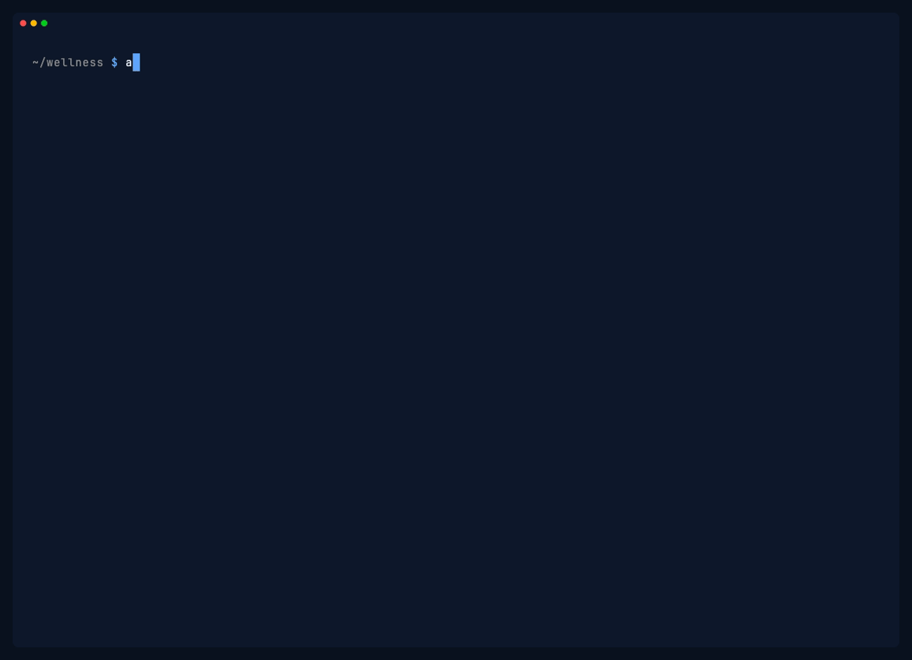

<div align="center">

# appstore-release

**Ship an iOS app to App Store review by asking your agent.**

[](https://skills.sh/beydemirfurkan/appstore-release) [](https://github.com/beydemirfurkan/appstore-release/actions/workflows/ci.yml) [](LICENSE) [](docs/reference.md#updated-for-ios-27)



<sub>Real output, recorded against the demo below.</sub>

</div>

<br>

```bash
npx skills add beydemirfurkan/appstore-release
```

Then tell your agent: **"Publish my app for review."**

The agent reads your app from App Store Connect and names everything that stands between it and review. It then fixes whatever Apple's API allows and submits only once nothing is in the way.

## Try it without an Apple account

```bash
git clone https://github.com/beydemirfurkan/appstore-release && cd appstore-release
source scripts/demo/setup.sh

appstore-release check
appstore-release release
appstore-release submit --submit
```

The demo runs against a local stand-in for App Store Connect, so nothing leaves your machine.

## How it works

**`preflight`** reads the app itself — Info.plist, privacy manifest, code — offline, and names what App Review rejects before you build: a permission prompt with no reason, accounts that cannot be deleted, a paywall with no restore. Each finding has the guideline, the file and line, and the fix.

**`check`** reads the whole app and returns a verdict with an ordered plan. Each finding says whether the tool can fix it or only you can.

**`release`** writes the listing: build, metadata in every locale, price, age rating, accessibility labels, screenshots, subscriptions with their offers and offer codes, and in-app purchases. It is idempotent; a second run sends nothing.

**`submit`** sends the version with any new plans and purchases, and refuses unless `check` says ready. `check --wait` then follows the review to its outcome.

Apple keeps the App Privacy label in its web UI; `check` tells you exactly where to click. An app's first subscription or in-app purchase goes with the version by API — and if App Store Connect will not take it, nothing is submitted and you get the clicks instead.

Using Expo? Your `store.config.json`, `eas.json` and `app.json` are read as they are.

## Skills

`appstore-release` reads the plan and hands each finding to the skill that knows that area:

- **app-store-preflight**: what App Review rejects in the app itself, before you submit
- **app-store-screenshot-upload**: exact sizes, iPhone Duo, iPad
- **app-store-age-rating**: the 2026 questionnaire
- **app-store-subscriptions**: plans, free trials, lifetime purchases
- **app-store-rejection**: read the reviewer's message, fix, resubmit
- **ios-code-signing**: EAS certificates and provisioning profiles
- **app-store-testflight**: groups, testers, What to Test, beta review
- **app-store-customer-reviews**: read customer reviews, draft replies, publish each after your OK

Coming from 3.x, where the skills were named `asc-*`? Remove the old ones, then add again:

```bash
npx skills remove asc-screenshots asc-age-rating asc-subscriptions asc-rejection asc-credentials asc-testflight asc-reviews
npx skills add beydemirfurkan/appstore-release
```

## Also runs as

- **Claude Code:** `/plugin marketplace add beydemirfurkan/appstore-release`
- **Claude Desktop:** open [`appstore-release.mcpb`](https://github.com/beydemirfurkan/appstore-release/releases/latest/download/appstore-release.mcpb)
- **Any MCP host:** `npx -y -p github:beydemirfurkan/appstore-release appstore-release-mcp` ([config](docs/reference.md#mcp-server))
- **CLI:** `npx github:beydemirfurkan/appstore-release check`

Connecting a real app takes an App Store Connect API key and a config file; the [reference](docs/reference.md#quick-start-with-a-real-app) walks through both.

<br>

<div align="center">
<sub>
Up to date with iOS 27 and App Store Connect API 4.5 · Zero dependencies · Node 20.11+<br>
<a href="docs/reference.md">Reference</a> · <a href="CHANGELOG.md">Changelog</a> · <a href="LICENSE">MIT</a> · Not affiliated with Apple
</sub>
</div>
