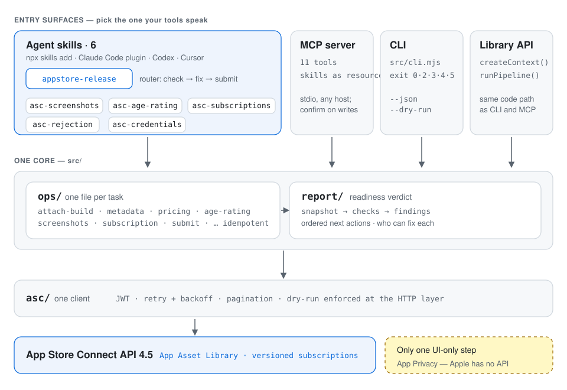

# Reference

Everything the [README](../README.md) leaves out: every install path, setup for a real app, commands, the MCP server, and how it is built.

- [Every way to install](#every-way-to-install)
- [Why not just an API wrapper](#why-not-just-an-api-wrapper)
- [Updated for iOS 27](#updated-for-ios-27)
- [What Apple keeps in the UI](#what-apple-keeps-in-the-ui)
- [Quick start with a real app](#quick-start-with-a-real-app)
- [The config, by feature](#the-config-by-feature) · [Commands](#commands) · [MCP server](#mcp-server) · [Safety](#safety) · [Architecture](#architecture) · [Requirements](#requirements) · [Contributing](#contributing)

## Every way to install

Pick whichever matches your tools. They share one engine, and none of them installs any dependencies.

**Any agent (Claude Code, Codex, Cursor, Gemini CLI and others), via [skills.sh](https://skills.sh/beydemirfurkan/appstore-release)**

```bash
npx skills add beydemirfurkan/appstore-release
```

**Claude Code plugin** (adds the skills and the MCP server together)

```
/plugin marketplace add beydemirfurkan/appstore-release
/plugin install appstore-release@beydemirfurkan
```

**Claude Desktop**: download [`appstore-release.mcpb`](https://github.com/beydemirfurkan/appstore-release/releases/latest/download/appstore-release.mcpb) and open it. It asks for your key and installs the MCP server. The same server is listed in the [MCP Registry](https://registry.modelcontextprotocol.io) as `io.github.beydemirfurkan/appstore-release`.

**Any other MCP host** (Cursor, Zed and the rest): see [MCP server](#mcp-server) below.

**CLI**, straight from GitHub (no npm package, nothing installed globally):

```bash
npx github:beydemirfurkan/appstore-release check
```

or from a clone: `node src/cli.mjs --help`.

## Why not just an API wrapper

Several MCP servers expose the App Store Connect API, some with more than a thousand tools. Raw endpoint coverage is not what's scarce. An agent that can call `PATCH /v1/appStoreVersionLocalizations/{id}` still does not know that:

- `whatsNew` returns **409 STATE_ERROR** on a first version,
- an emoji in the description is a hard **409 ATTRIBUTE.INVALID.INVALID_CHARACTERS**,
- the age-rating declaration lives on `appInfos`, not the version, and must be sent complete,
- a screenshot that skips its commit step stays invisible forever, with nothing in the UI to say why,
- the App Asset Library's placement groups come from runtime reference data, not an enum.

Endpoint coverage hands the model these landmines. This tool defuses them with **13 outcome-shaped MCP tools**, and the most important one answers the question that matters: _can this version be submitted, and if not, what is next?_

## Updated for iOS 27

App Store Connect API 4.4.1 and 4.5.1 (September/October 2026) changed how submission works. This release follows them:

- **App Asset Library.** Screenshots upload through the library, the only place iPhone Duo screenshots exist. Placement groups and exact pixel specs are read from `appAssetLibraryRefData`, so a new device needs no update here. Files are deduplicated across locales. The deprecated screenshot-set API remains a fallback (`screenshots.api`).
- **iPhone Duo.** Add a set with `placementGroup`; `screenshots --list-groups` prints what Apple offers. `check` reminds you before Apple's April 2027 requirement for apps built with the iOS 27.1 SDK.
- **Later subscriptions go through the API.** Versioned subscriptions are added to the same review submission as the app version. An app's _first_ subscription is still submitted from the website with the binary, as Apple requires; `check` gives the clicks.
- **Age rating.** `INFREQUENT`/`FREQUENT` (older spellings still accepted), `socialMedia` and `socialMediaAgeRestricted` (required since September 2026), and `ageRatingOverrideV2`.
- **Sizes.** Every accepted 6.9" and 13" size and landscape. Screenshots with an alpha channel are refused before upload.

What no API exposes, and the skills therefore cover as guidance: builds must use the iOS 27 SDK from April 2027, and an iOS 27 SDK build needs a launch screen and the scene lifecycle.

## What Apple keeps in the UI

1. **App Privacy → Data Collection.** Every `appDataUsages*` endpoint returns 404. `check` blocks with the exact clicks until you publish the label in App Store Connect and set `"review": { "privacyPublished": true }`. That records your word for it; it is not presented as verified.
2. **Maybe: an app's first subscription or in-app purchase.** Apple's 4.4.1 notes say _"Submit your first subscription together with an app binary submission through appstoreconnect.apple.com"_, while teams submit it by API in the same review submission as the version. `submit` does the latter; if App Store Connect refuses, nothing is submitted, the product items are removed from the draft, and the result is `manual` (exit 5) with the website's clicks. `submit --submit --skip-products` sends the app alone. Not yet confirmed on a live account either way.

## Quick start with a real app

1. **Create an API key**: App Store Connect → Users and Access → Integrations → App Store Connect API, role **App Manager**. Download the `.p8` and note the Key ID and Issuer ID ([setup](../skills/appstore-release/references/setup.md)).
2. **Scaffold a config** with `appstore-release init`. It writes `appstore.config.json` with a `$schema`, so editors autocomplete it. The [template](../skills/appstore-release/references/config-template.json) shows every block: locales, screenshot sets, paid price, age rating, subscription.
3. **Run it:**

```bash
export ASC_KEY_ID=ABCDE12345
export ASC_ISSUER_ID=69a6de00-…
export ASC_P8_PATH=/abs/AuthKey_ABCDE12345.p8   # or ASC_P8 with the key inline
export ASC_APP_ID=1234567890                    # the digits in the App Store Connect URL

appstore-release doctor              # credentials, tools and config; touches no app data
appstore-release check               # what is missing, in the order to fix it
appstore-release release --dry-run   # exactly what would change
appstore-release release             # apply it; safe to re-run
appstore-release submit --submit     # refuses unless the verdict is ready
```

(`appstore-release` is `node /path/to/src/cli.mjs`: symlink it, alias it, or spell it out.)

## The config, by feature

| You want                          | Config                                                             | Notes                                                               |
| --------------------------------- | ------------------------------------------------------------------ | ------------------------------------------------------------------- |
| Listing in several languages      | `metadata` + `locales: { "tr": {…} }`                              | each locale inherits what it leaves out                             |
| An Expo project's EAS Metadata    | `"easMetadata": "./store.config.json"`, or just the file           | ours wins on overlap; app id from eas.json, bundle id from app.json |
| Screenshots from any generator    | `"screenshots": { "from": "./exports" }`                           | grouped by pixel size into iPhone, iPad, Duo sets                   |
| Explicit device sets / iPhone Duo | `screenshots.sets: [{ dir, displayType? , placementGroup? }]`      | `screenshots --list-groups` prints Apple's groups                   |
| Several subscription plans        | `subscriptions: [{ productId, name, period, group, … }]`           | created when missing; `subscription` (one) still works              |
| A free trial or intro price       | `introOffer: { type, duration, periods?, priceAmount? }` on a plan | `FREE_TRIAL`, `PAY_AS_YOU_GO`, `PAY_UP_FRONT`                       |
| A lifetime unlock                 | `inAppPurchases: [{ productId, name, … }]`                         | `NON_CONSUMABLE` by default                                         |
| TestFlight                        | `testflight: { whatToTest, groups, testers, … }`                   | run with `appstore-release testflight`                              |
| Release timing                    | `release: { type, earliestDate?, phased? }`                        | `MANUAL`, `AFTER_APPROVAL`, `SCHEDULED`                             |

Every key is in the [JSON Schema](../schemas/config.schema.json), and the [template](../skills/appstore-release/references/config-template.json) shows them together.

## Commands

| Command                    | What it does                                                                                     |
| -------------------------- | ------------------------------------------------------------------------------------------------ |
| `init` `schema` `validate` | scaffold a config, print its JSON Schema, check it offline (no credentials needed)               |
| `doctor`                   | verify credentials, `openssl`, Node and config without touching app data                         |
| `status`                   | full read-only inventory                                                                         |
| `check`                    | readiness report: verdict, findings, ordered next actions; `--wait <min>` follows a review       |
| `release`                  | the whole listing pipeline, then a check                                                         |
| `new-version [x.y.z]`      | open the next version when every version is live                                                 |
| `attach-build`             | attach the newest VALID build for this version (or `--build <n>`)                                |
| `metadata`                 | name, subtitle, description, keywords, promo text, URLs, in every configured locale              |
| `pricing`                  | price schedule (free or paid, nearest price point) and copyright                                 |
| `content-rights`           | third-party content declaration                                                                  |
| `age-rating`               | the full age-rating declaration                                                                  |
| `category`                 | primary and secondary category                                                                   |
| `review-info`              | App Review contact and demo account                                                              |
| `release-options`          | manual, after approval, scheduled, phased release                                                |
| `screenshots`              | diff, then upload; `--list-groups`, `--no-prune`                                                 |
| `subscription`             | plans (created when missing), localizations, price, intro offer, review screenshot               |
| `in-app-purchases`         | one-time purchases (created when missing): localizations, availability, price, review screenshot |
| `submit --submit`          | submit the version with any plans and purchases that need review; `--resolved` after a rejection |
| `reviews`                  | customer reviews, newest first; `--rating 1,2`, `--unanswered`, `--territory`, `--summary`       |
| `reply <reviewId>`         | publish a reply (`--text`) or remove it (`--delete`); the same text twice is a no-op             |
| `testflight`               | export compliance, What to Test, beta groups, testers, beta app review                           |
| `credentials`              | distribution certificate and provisioning profile (fixes stale EAS credentials)                  |
| `mcp`                      | run the MCP server on stdio                                                                      |

`appstore-release <command> --help` lists a command's own flags. Global flags: `--json` (one JSON document on stdout), `--dry-run`, `--config`, `--project-root`, `--app-id`, `--verbose`, `--quiet`, `--exit-zero`.

**Exit codes are designed for scripts:** `0` ok · `2` usage · `3` config/credentials · `4` blocked but fixable · `5` only a human in App Store Connect can finish · `8` still in review when `check --wait` ran out of time. That makes `appstore-release check && appstore-release submit --submit` safe in CI.

## MCP server

Nothing to install: `npx` fetches it from GitHub on first use (no npm package involved) and caches it.

```jsonc
{
  "mcpServers": {
    "appstore-release": {
      "command": "npx",
      "args": ["-y", "-p", "github:beydemirfurkan/appstore-release", "appstore-release-mcp"],
      "env": {
        "ASC_KEY_ID": "ABCDE12345",
        "ASC_ISSUER_ID": "69a6de00-…",
        "ASC_P8_PATH": "/abs/AuthKey_ABCDE12345.p8",
        "ASC_APP_ID": "1234567890",
      },
    },
  },
}
```

Pin a release with `github:beydemirfurkan/appstore-release#v3.0.0`. From a clone, use `"command": "node", "args": ["/abs/path/to/appstore-release/src/mcp/server.mjs"]` instead.

| Tool                         | Read-only | Purpose                                                                                  |
| ---------------------------- | --------- | ---------------------------------------------------------------------------------------- |
| `asc_readiness_report`       | ✓         | verdict, findings, ordered next actions (**start here**); `waitMinutes` follows a review |
| `asc_app_overview`           | ✓         | inventory of the app's current state                                                     |
| `asc_list_apps`              | ✓         | find the numeric app id from a name or bundle id                                         |
| `asc_validate_config`        | ✓         | check a config, with no network and no credentials                                       |
| `asc_plan_release`           | ✓         | dry-run the pipeline and return the diff                                                 |
| `asc_open_next_version`      |           | create the next version when every version is live                                       |
| `asc_apply_release`          |           | write the listing (never prunes screenshots)                                             |
| `asc_upload_screenshots`     |           | diff, then upload                                                                        |
| `asc_configure_subscription` |           | subscriptions and in-app purchases from the config                                       |
| `asc_submit_for_review`      |           | irreversible; refuses unless ready; `resolved` after a rejection                         |
| `asc_customer_reviews`       | ✓         | reviews and Apple's summary; filter to unanswered or low-rated                           |
| `asc_reply_to_review`        |           | publish one approved reply; replaces any earlier one                                     |
| `asc_generate_credentials`   |           | off unless the operator opts in                                                          |

Every mutating tool requires `confirm: true`, which forces a two-turn handshake that the host shows the user. Every skill and reference is also served as a resource: `appstore-release://skills/<name>`, plus `://gotchas`, `://runbook`, `://config-schema` and `://config-template`.

## Safety

- **Idempotent.** A second run with nothing changed sends nothing. The end-to-end test asserts this across the whole pipeline.
- **`--dry-run` is enforced in the HTTP client**, not in each operation, so no operation can forget it.
- **Credentials never enter tool arguments.** Arguments are visible to the model and end up in transcripts. Keys come from the environment only, and a test asserts no tool accepts one.
- **Certificate slots are never spent silently.** Apple allows three per account. `credentials` reuses one whose key you hold and asks before issuing another.
- **Agents never delete by omission.** MCP tools do not prune screenshots unless asked, and the pipeline tool refuses steps outside the pipeline.

## Architecture

<picture>
  <source media="(prefers-color-scheme: dark)" srcset="media/architecture-dark.svg">
  
</picture>

```
src/
  cli.mjs      dispatcher · cli/     args, rendering, doctor, offline commands
  index.mjs    library API: createContext, runOperation, runPipeline, getReadinessReport
  core/        context · credentials · config · schema · findings · version states
  asc/         client (retry, pagination, dry-run) · jwt · asset-library · screenshot-sets · png
  ops/         one file per task, uniform { meta, run(ctx, args) } contract
  report/      snapshot → checks/ → report → three renderers
  mcp/         server, tools, resources
skills/        the router skill and five focused skills
```

The CLI, the MCP server and the skills all call the same library API, so they cannot drift apart:

```js
import { createContext, getReadinessReport, runPipeline } from "./src/index.mjs";

const ctx = await createContext({ config: "./appstore.config.json", dryRun: true });
const report = await getReadinessReport(ctx);
if (report.verdict === "ready") await runPipeline(undefined, ctx);
```

## Requirements

- Node.js 20.11+. **No runtime dependencies**: `fetch`, `crypto` and the JSON-RPC layer are built in or live in this repo. `npm install` is only needed to develop it.
- `openssl`, only for the `credentials` command.
- An iOS app already uploaded to App Store Connect. The build step assumes Expo/EAS; everything else works for any iOS app.

## Contributing

`npm ci && npm run verify` runs typecheck, format, schema, manifests, the distribution and skill gates, and the tests. There is no build step: the files that ship are the files you edit. `npm run media` re-records the GIFs from the real CLI.

Issues and PRs are welcome, especially new gotchas, new checks, and the roadmap: accessibility nutrition labels, app previews through the asset library, promotional offers and offer codes, and replying to customer reviews. Keep operations idempotent and config-driven per [the contract](../src/ops/_contract.md), and add a test.
